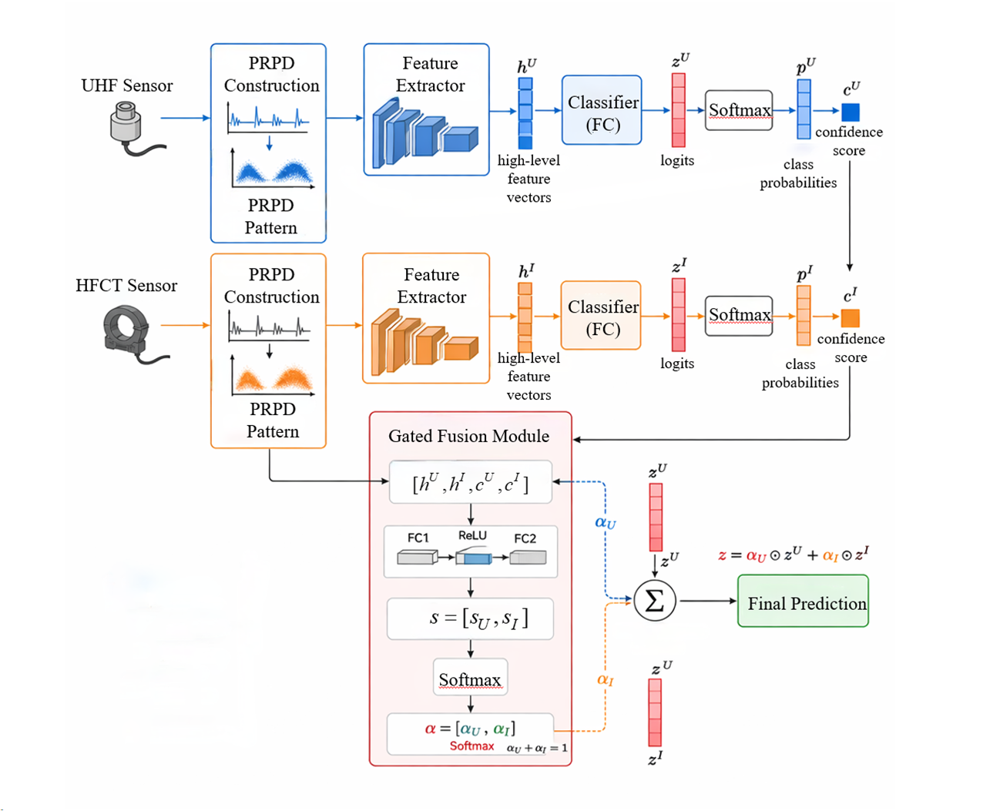

# Dual-Channel Gated Fusion for GIS Partial Discharge Identification

Paired UHF/HFCT waveforms → PRPD → twelve paired 30° phase tiles → gated logit fusion → original-record classification.



## Paper experiment

This section documents the **12-tile, clean-trained experiment** used in the current revision. The global-plus-three-region, frozen-expert and noise-trained gate experiments below are separate development studies. Their checkpoints and results are not interchangeable.

| Setting | Paper experiment |
|---|---|
| Original records | 791: jd 188, qx 201, xf 200, ym 202 |
| Train / validation / test | 474 / 158 / 159 original records |
| Split seed / training seed | **42 / 3407** |
| Representation | 12 paired 30° phase tiles per record, 224×224 RGB |
| Training | Clean images, ImageNet initialization, no online noise, no auxiliary branch loss |
| Methods | `uhf`, `hfct`, `concat`, `equal`, `gfm`, `gfm_no_conf` |
| Optimization | Adam, learning rate 0.001; StepLR every 10 epochs, factor 0.1; 30 epochs; batch size 32 |
| Checkpoint selection | Clean validation **tile-level macro-F1**, first maximum |
| Reported evaluation | Mean of 12 tile softmax probability vectors per original record |
| Fixed test noise | AWGN: −15, −10, −5 dB; both / UHF only / HFCT only |

The split is stratified by class at the **original-record level**. Tiles from one record never cross subsets. The implementation does not enforce acquisition-session, physical-specimen or voltage-held-out partitions; independent acquisition is author-declared provenance. The same test partition was inspected under earlier development representations, so it is not an untouched external validation dataset.

### Architecture

Each sensor has a ResNet50 producing a pooled 2048D vector. Two separate paths use this vector:

- Gate feature: `2048 → 512 → ReLU`.
- Classifier: `2048 → 512 → ReLU → Dropout(0.5) → 4 logits`.

Channel confidence is the maximum softmax class probability. Concatenating two 512D gate features and two scalar confidences gives a 1026D input. The gate is `Linear(1026,128) → ReLU → Linear(128,2) → Softmax`. Its two weights sum to one and combine the **branch logits**. Each paired tile is processed separately; only the final class probabilities are averaged across 12 tiles.

`gfm_no_conf` replaces both confidence scalars with zero while retaining the gate dimensions. `equal` jointly trains an average of branch logits. `concat` learns a linear classifier on concatenated 512D features. These end-to-end comparisons do not use the identical frozen experts employed by the separate reliability studies.

### Preprocessing and noise

CH1 = UHF, CH2 = power-frequency phase reference, CH3 = HFCT. WFM triplets and supported three-channel CSV exports are read by `mso44_wfm.py` and `mso44_csv.py`.

`revision_data.py` imports the `legacy_*` helpers from `generate_prpd_wfm.py`: CH2 zero-crossing phase estimation (21-point smoothing), pulse threshold `median(abs(x)) + 8*MAD(abs(x))`, and peak grouping with a 2 μs gap (at least five samples). The tile path does not use the separate high-pass/envelope whole-image routine in that file. The amplitude reference is the pooled 99th percentile of clean **training** pulse amplitudes per channel; the historical split-42 references were UHF 0.019375 V and HFCT 0.04566875 V. Values are transformed by `asinh(2*amplitude/a_ref)/asinh(2)` and clipped to [0,1]. Validation and test never refit the references.

Images use ImageNet normalization, without random cropping or flipping. Noise is added to the **waveform before pulse extraction and drawing**, not to image pixels. Reference power is `mean((x - median(x))**2)` over the complete captured waveform, including existing background. Demeaned Gaussian noise is scaled to the requested power ratio. Both-channel noise is independently generated per channel using each channel's own reference power; CH2 remains clean. The fixed seed is 2026, hashed with record identity and channel. The same channel uses matched noise across the three pollution directions and SNRs.

### Reproduction

Install PyTorch 2.9.1 / torchvision 0.24.1 with the appropriate CUDA wheel, then `pip install -r requirements.txt`. The recorded server used CUDA 12.8 wheels and RTX 4090. Supporting package ranges are not a historical environment lock. Raw data and model files are not bundled.

Use the exact archived original-record manifest to reproduce historical memberships. A random seed alone is insufficient if the record ordering or accepted captures differ. Keep existing manifests, checkpoints and result directories unchanged.

For a fresh tile representation of that archived split:

```bash
python -B revision_data.py tile-fit \
  --data "$RAW_DATA" --parent-manifest "$PARENT_MANIFEST" --output "$TILES"
python -B revision_data.py tile-render --data "$RAW_DATA" --output "$TILES"
```

The parent manifest must be the split-42 manifest. Do not use `region-fit`, `region-resplit` or the split-3407 study for this experiment. Training reproduction (not required to evaluate the saved models):

```bash
CUDA_VISIBLE_DEVICES=1 python -B revision_train.py \
  --data "$TILES" --output "$NEW_TRAIN_RUN" \
  --methods uhf hfct concat equal gfm gfm_no_conf --seeds 3407 \
  --epochs 30 --batch-size 32 --selection-unit tile --validation-only
```

For fixed noisy **test** tiles:

```bash
for snr in -15 -10 -5; do
  for target in both uhf hfct; do
    python -B revision_data.py tile-render \
      --data "$RAW_DATA" --output "$TILES" \
      --noise-split test --snr-db "$snr" --target "$target" || break 2
  done
done
```

Evaluate saved checkpoints without training:

```bash
CUDA_VISIBLE_DEVICES=1 python -B scripts/evaluate_tile_test.py \
  --data "$TILES" --source "$TRAIN_RUN" --output "$NEW_TEST_RUN" \
  --seed 3407 --expected-split-seed 42
```

Historical server paths: `TILES=/home/aa/cl-2/revision_output_tiles`, `TRAIN_RUN=/home/aa/cl-2/runs/tiles_val_seed3407`; the completed terminal evaluation is in `/home/aa/cl-2/runs/tiles_test_seed3407`. **There is no need to rerun that completed evaluation.** The packaged evaluator provides a repeatable entry point using the same `Paired`, `build_model` and `evaluate` functions, with extra preflight checks and provenance. It refuses existing output directories and never updates the source models. A complete run has 60 rows (six models × ten conditions), each with 159 original-record predictions. Its end-to-end execution on the private server data has not yet been repeated as a standalone script.

### Test results and limits

Clean test accuracy: UHF 98.74%, HFCT 98.74%, concat 98.11%, equal 100.00%, GFM 98.74%, GFM without confidence 98.74%.

| UHF-only noise | Concat | Equal | GFM without confidence | GFM |
|---|---:|---:|---:|---:|
| −15 dB | 52.20 | 52.83 | 57.23 | **70.44** |
| −10 dB | 46.54 | 51.57 | 57.23 | **65.41** |
| −5 dB | 46.54 | 63.52 | 51.57 | **65.41** |

Accuracy (%), transcribed from the author's completed server output. This table displays selected UHF-only test conditions, not the complete set of measured conditions. The advantage is conditional on UHF-only pollution in these tested conditions; neither consistent HFCT-only/both-channel gains nor repeated-seed superiority is established. The repository does not include private prediction files or independently re-verify the reported numbers.

### Code map

| File | Role |
|---|---|
| `revision_data.py` | Shared record audit, tile fitting/rendering and waveform AWGN; also contains region exploration |
| `revision_train.py` | `Encoder`, `FusionNet`, `Paired`, tile training and record aggregation |
| `scripts/evaluate_tile_test.py` | Fixed-checkpoint test evaluation, separate output, no training |
| `generate_prpd_wfm.py` | Imported legacy helpers; standalone whole-image entry point is a different preprocessing path |
| `mso44_wfm.py`, `mso44_csv.py` | Raw waveform adapters |
| `recovered_models.py` | Historical concat/equal/Swin baselines, not the paper's six-model table |
| `revision_reliability.py` | Exploratory frozen **region** experts and 1038→64→2 gates; not the paper's 1026→128→2 gate |
| `revision_temporal.py` | Exploratory sliding-window planning/pilot; not part of the paper protocol |
| `scripts/render_validation_noise.sh` | Region validation rendering, not paper tile test rendering |
| `scripts/run_split3407_seed_study.sh` | Separate region/split-3407 study, not required here |
| `scripts/sync_from_server.py` | Allowlisted source synchronization; does not establish result validity |

SVM and a standalone CNN baseline are not implemented in these published experiment scripts. Do not describe their settings as verified by this code.

The author-verified original Swin-T, ResNet50, concatenation and equal-fusion sources are documented in [the baseline audit](docs/BASELINES.md). Optional methods `swin_uhf`, `swin_hfct`, `recovered_concat` and `recovered_equal` already share the training entry point and are now accepted by the test evaluator when matching checkpoints exist. This interface update does not add completed experiments or change the default six-model paper protocol.
